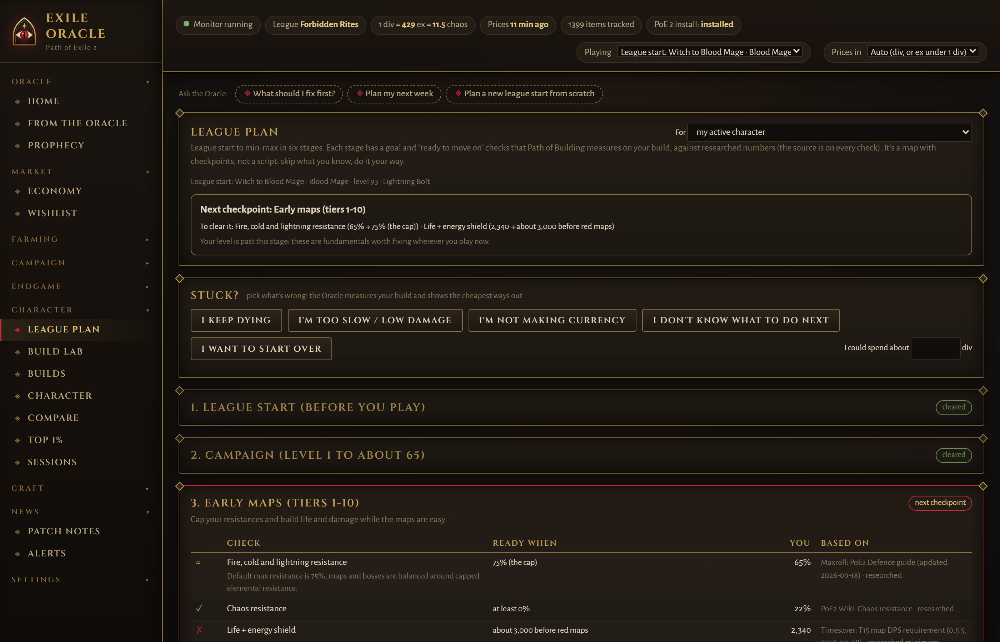
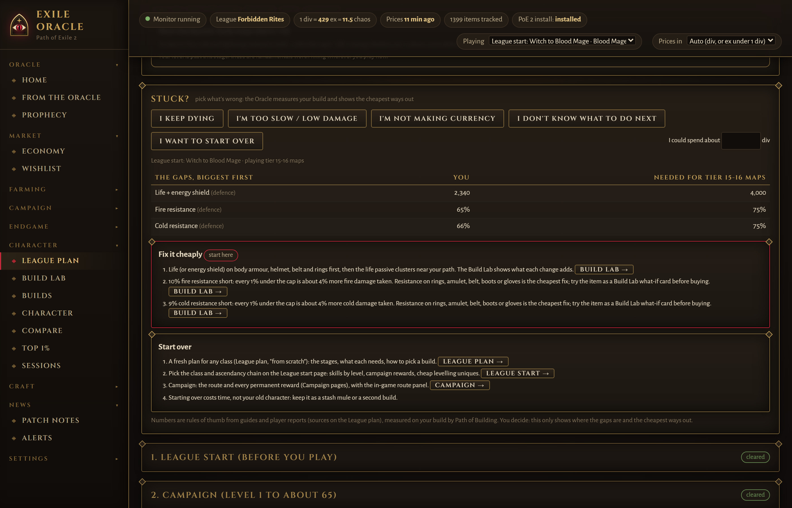
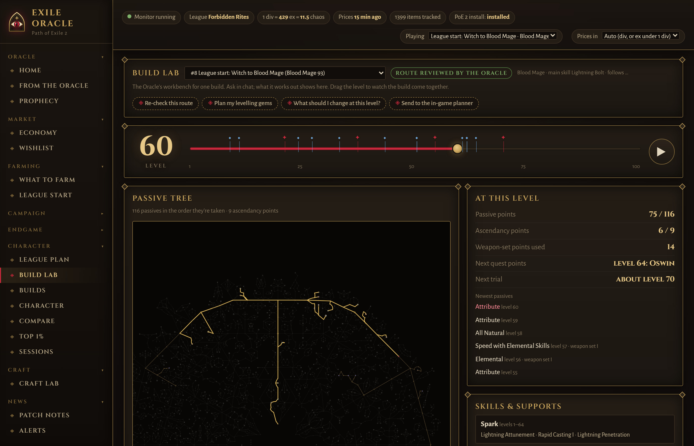
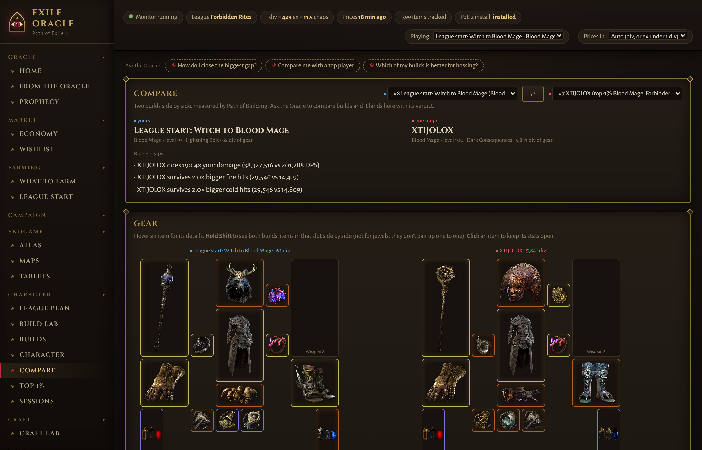
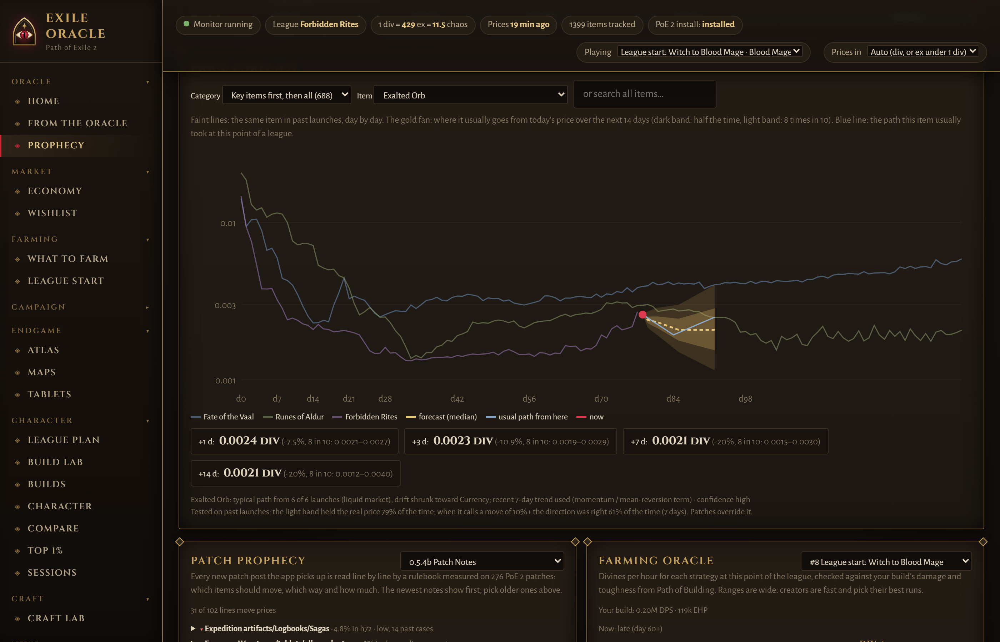
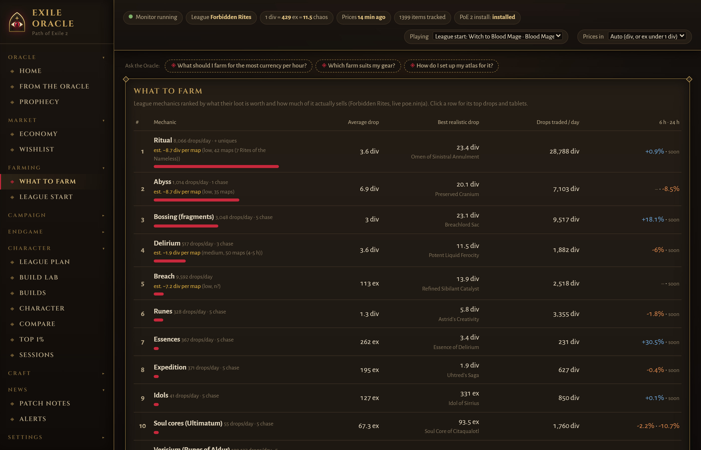
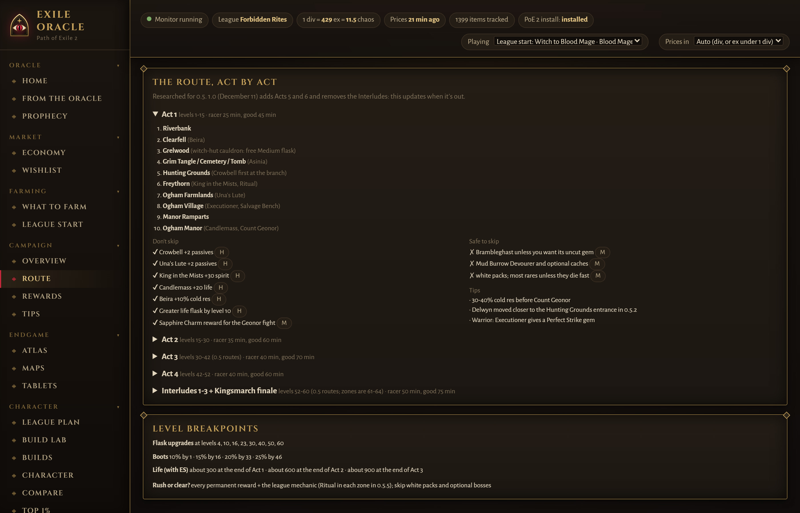
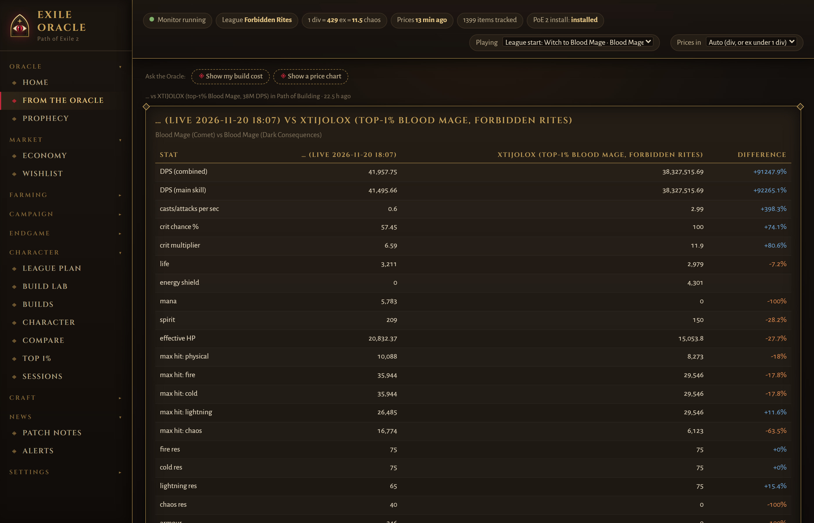

# Exile Oracle

**A Path of Exile 2 companion that measures your build, reads the market and the history of past leagues, and tells
you what to do next.** It runs on your own PC (Windows and Linux), it's free, and it's built to work with Claude: ask
in plain words, and the answer comes with real numbers and shows up on your dashboard.

**[⬇ Download the latest version](../../releases/latest)** · **[Using it with Claude](CLAUDE-GUIDE.md)** ·
**[Every page, in pictures](docs/GALLERY.md)** · **[The research behind it](research/README.md)** ·
**[Help](TROUBLESHOOTING.md)**



## What makes it different

- **Measured, not guessed.** Every build suggestion is run through Path of Building on *your* build first: damage,
  effective HP, the biggest hit you survive per damage type, resistances. You see the difference before you spend
  a single orb.
- **Research you can check.** The forecasts, farming numbers and league timing come from published research with
  its data and scripts ([research/](research/README.md)). Every number says where it comes from and how sure it is.
  The price forecast was tested on six launches: its range held the real price 80% of the time.
- **Made for AI.** 36 tools and built-in instructions let Claude (or ChatGPT, or Gemini) look at your character, the
  economy and your plan, then answer at your level, from a quick tip for a new player to the raw numbers for a
  veteran.
- **One app instead of ten.** League plan, build lab, price-check overlay, market history, forecasts, atlas planner,
  campaign route, crafting, wishlist and alerts, all reading the same character.
- **Honest.** Rules of thumb are labelled as rules of thumb, forecasts come as ranges, and anything it can't measure
  says "not measured" instead of guessing.
- **Built not to break.** No internet, Path of Building not installed yet, a build that can't be read, even a
  damaged data file: you get a plain message, it keeps working from saved data, and a daily backup keeps your
  builds and choices safe.
- **Safe for your account.** Read-only toward the game, public data only, nothing about you leaves your PC.

## What it does

The sidebar is grouped the same way: open a group to see its pages. A first start shows only the group you're in. Every page has a
picture in **[the gallery](docs/GALLERY.md)**.

**Home** is the morning check: the Divine rate and the main currencies with their 7-day change, today's omen, your
latest alerts, and a "Feeling stuck?" way into the League plan.

### Plan your league
- **League plan:** your league in six stages: league start, campaign, early maps, red maps, juicing and pinnacle
  bosses, min-max. Each stage has a goal and "ready to move on" checks measured on your build against researched
  numbers, with the source on every check. It shows your next checkpoint and what clears it, which farming
  strategies your build can already run, and which one is closest. No build yet? Plan from scratch for any class.
- **Stuck?** Say what's wrong (I keep dying, I'm too slow, I'm not making currency, I don't know what to do next, I
  want to start over). It measures your build against the content you play, shows the gaps biggest first, and gives
  three ways out: fix it cheaply, respec, or start over with a plan sized to the currency you have. When the numbers
  are fine, it says so.



### Your build
- **Build Lab:** the workbench for one build.
  - A living roadmap: drag the level from 1 to 100 and the passive tree lights up in the order you take nodes, with
    the skills, supports and gear for that level.
  - Power curves from real Path of Building runs at each level.
  - What-if cards: every idea, measured before you buy (DPS, effective HP, biggest hits, resistances, cost).
  - Upgrades ranked by damage per divine, a defence sheet, and ready / risky / not yet for every pinnacle boss.



- **Character:** gear in the game's equipment layout (click an item to keep its stats open), skills, the passive
  tree and what everything is worth. **Build check** shows how Path of Building measured the build and fixes known
  import problems by itself (for example, weapons only in the second weapon set).


- **Builds:** your vault. Paste a Path of Building code or a pobb.in, pastebin or poe.ninja link; open a build on
  the Character page, or delete it.

- **Compare:** two builds side by side: both sets of gear (hold Shift to see both items in a slot), a shape chart,
  stat bars, the biggest hits, and both passive trees on one tree.



- **Top 1%:** you against the top 1% of your ascendancy on level, damage, toughness and gear value, and what
  closes the gap. **View profile** opens a top player's page with a **Save this build** button.

- **Sessions:** your play time from the game's own log: maps per hour, average map time, deaths, time per act.

### The market
- **Economy:** the Divine rate, the league's chase items, the biggest movers, and **Exchange gaps** (the same item
  cheaper in one currency than another on the Currency Exchange, shown only when the gap held for hours with real
  volume on both sides).


- **Market history:** every Currency Exchange item with its price, stock and 7-day trend.

- **Wishlist:** items you want to track, with or without a target price (div, ex or chaos): the live price, the
  last 7 days and next week's likely range. You get an alert at your target, when the forecast says it's heading
  there, or when patch notes call a move.
- **Wanted items:** for one specific item (say, a staff with exact stats), paste its trade-site link or the item
  itself. Press **Check now** to see the cheapest listings, which ones are new, re-priced or gone, and follow one
  listing with a pin. **Open this listing** opens just that one on the trade site, and **Copy whisper** gives you
  the message to the seller.

### The Oracle: what usually happens next
- **Prophecy:** a daily omen with its evidence, countdowns to 1.0 and each league phase, and a league timeline with
  "you are here".

- **Price forecasts** for 688 exchange items: their daily price in the last three launches, the path they usually
  take from this point, and a fan for the next 14 days.



- **Patch prophecy:** reads each new patch post and says which items should move and by how much, from a rulebook
  measured on 276 patches. The **farming oracle** gives divines per hour per strategy for your build.

- **Chase uniques through a league** (Mageblood, Headhunter, Temporalis and 45 more) and **market timing**: what to
  sell, hold or buy at this point of the league.

### Farming
- **What to farm:** league mechanics ranked by what their loot really sells for, with drop estimates from tracked
  runs.
- **League start:** what each mechanic's loot sold for on days 1 to 7 of the last three launches, and a planner for
  any class and ascendancy path (skills by level, cheap levelling uniques, campaign rewards).



### Campaign
**Overview, Route, Rewards and Tips:** the fastest route act by act, every permanent reward with a checklist, the
ascendancy trials, and flask, boots and life breakpoints. **In game**, a small route panel follows your zone (from
the game's own log): where to go next and which rewards not to skip. It's click-through and never takes focus.




### Endgame
- **Atlas:** the atlas tree read from your own game files. **Show on tree** draws a strategy's whole setup; eleven
  strategies with what they earn now and in the next league phase.
- **Maps:** what each strategy earns per hour at your own map pace (from the game log), as an honest range; waystone
  rolling at live prices; every waystone modifier rated deadly, risky or fine for your build, with search strings.
- **Tablets:** every tablet type, what to pair with each strategy, and tablet modifiers.


### Crafting
**Craft lab:** plan a craft with every mod's tier, practise it step by step at live currency prices, and record what
really happened.

### In game: the price-check overlay (Windows)
Press **Ctrl+D** on an item: the poe.ninja price, live trade-site prices if you switch them on, a craft estimate
for rares, and **Ask the Oracle**. On a waystone or tablet it rates every modifier for your build. Ctrl+Alt+D keeps
it open; the keys can be changed.

 

### News and alerts
- **Patch notes:** every line of a patch that touches your builds, tagged buff or nerf.
- **Alerts:** only what you choose: your items, your wishlist, the Oracle's calls, patch notes, news, updates. Market
  moves come as one daily digest, and only real moves count. Nothing pops up in game.

### Works with your AI
- Connect Claude with one click in Settings. ChatGPT (desktop app / Codex) and Gemini CLI connect the same way.
- **Ask the Oracle** buttons on every page open your AI app with the question already typed in.
- **From the Oracle:** answers land on your dashboard (here, a build against a top-1% Blood Mage).
- **How well do you know PoE 2?** Tell it once (new or returning, a fair bit, veteran) and it explains just enough.



### Keeps itself up to date
After a patch (1.0 included), what Exile Oracle knows about the game updates by itself within hours: it notices the
game update and checks for new data every hour for two days. Each data update is checked file by file before it's
used, and the previous data is kept so it can go back. New features come as app updates with a one-click banner.

**[See every page in the gallery →](docs/GALLERY.md)**

> Character screenshots show a public top-player build from poe.ninja. Yours shows your own characters once you
> import them.

## Get started

### Windows
1. Download `ExileOracle-Setup-<version>.exe` from **[Releases](../../releases/latest)** and run it. Windows may say
   *"Windows protected your PC"* (the installer isn't code-signed): **More info → Run anyway**.
2. It installs for your Windows user (no admin) and starts; the Exile Oracle eye appears by the clock. Click it for
   the dashboard; right-click for *Start with Windows* and *Quit*.
3. The first start downloads prices, the community game data and Path of Building (about 2 minutes).
4. **Settings → Your profile:** your class, ascendancy and how well you know the game.
5. **Settings → Connect to Claude**, then read **[the Claude guide](CLAUDE-GUIDE.md)** for what to ask.

### Linux and Steam Deck
1. Download `exile-oracle-linux-x86_64-<version>.tar.gz` from **[Releases](../../releases/latest)** and unpack it.
2. In a terminal in that folder: `sh install.sh` (add `--autostart` to start it when you log in). It installs for
   your user only, with no sudo, and brings its own Python and Lua, so it works on SteamOS's read-only system too.
3. Open **Exile Oracle** from the app menu, or `http://127.0.0.1:47830` in your browser. On a Steam Deck, do this
   in Desktop Mode; *Add to Steam* opens it from Game Mode.

It finds the game through Steam (including Flatpak Steam and SD cards), reads its log through Proton, and finds Path
of Building under Wine or Proton for character import. Your data stays in `~/.local/share/poe2toolkit`;
`sh uninstall.sh` removes the app (`--purge` removes your data too). The price-check overlay is Windows-only for now.

## Safety and privacy
- **Read-only toward the game:** no input to the game, no memory reading, no changes to game files. Your GGG login
  stays inside Path of Building.
- **Public data only:** poe.ninja's economy data, GGG's public Currency Exchange history, Steam news, the community
  game-data export (RePoE), Path of Building, and the game's own log file on your PC.
- **GGG's trade site** is used only when you press something (the overlay's live prices, or **Check now** on a
  wanted item), one search at a time, within GGG's rate limits, with no login. It's off until you switch it on.
- **Polite:** prices every 30 minutes, exchange history hourly.
- **Nothing about you leaves your PC.** Reports and suggestions are sent only when you press Send, and you see what
  is sent first.

## The research
Every prediction in the app comes from research you can read and re-run in **[research/](research/README.md)**:
market trends over three launches, the first 72 hours hour by hour, a price forecast tested on six launches, 276
patches matched to the price moves after them, divines per hour for 22 farming strategies, chase uniques over five
leagues, 20+ PoE 1 leagues as labelled analogy, the atlas, the campaign and boss requirements. Each topic has a
report, its data and the scripts that measured it. Findings are tagged by how sure they are, and community claims
are checked against the data.

## Help
Exile Oracle is young, so things can still go wrong:
- **With Claude:** ask it to fix it. It runs `poe2_doctor`, which checks every part, and follows
  **[TROUBLESHOOTING.md](TROUBLESHOOTING.md)**.
- **Without Claude:** TROUBLESHOOTING.md works for people too.
- **Still stuck?** **[Open an issue](../../issues/new?template=bug_report.md)**, or use **Report an issue** in the app.

## Build it yourself
Needs Python 3.15, Inno Setup 7 and (for the bundled art) a local extraction of your own game files:
```
python make_datapack.py          # refresh the data pack
python build_release.py --setup  # stage + privacy scan + installer
```
`python smoke_test.py` tests every page and tool; `release/chaos_test.py` runs every tool and page with no internet,
an empty data folder and nonsense input.

## Credits and licences
See [release/LICENSES.md](release/LICENSES.md). Path of Building Community (MIT), RePoE, poe.ninja, Python.
**Not affiliated with or endorsed by Grinding Gear Games.** Path of Exile and all of its artwork are © Grinding Gear
Games; this free, non-commercial fan tool bundles some game art for its pictures and icon, and will remove it on
request.
