# Exile Oracle

*(formerly PoE 2 Toolkit)*

A free, personal **Path of Exile 2 companion** for Windows and Linux:

- **the Oracle:** a daily omen, a league timeline, price forecasts and patch prophecy, all from researched league history;
- **Endgame (Atlas, Maps, Tablets):** atlas strategies drawn on your tree, waystone rolling and juicing, map mods rated for your build, tablets;
- **the campaign:** a rush guide, plus a route panel in game that follows your zone;
- **your characters:** the Build Lab, a Top 1% check and upgrades;
- **the economy:** live prices, what to farm, a league-start playbook;
- **a price-check overlay** that also rates waystones for your build.

Also in it: play-session tracking, a craft lab, and patch notes checked against your builds. It runs on your own PC in its own window, and it's built to be used
**together with Claude**: connect it once and ask Claude anything about your character, the economy or your next
craft.

> **Made for Claude, works with other AI apps too.** Exile Oracle is built and tested mainly with Claude, and that's
> the way it's meant to be used. Its tools are a standard MCP server, so other apps can connect from Settings →
> Other AI apps:
> - **Gemini CLI**: tested (needs a Gemini API key).
> - **ChatGPT desktop app / Codex**: supported but not yet tested.
>
> Every app gets the same built-in instructions.

**[⬇ Download the latest installer](../../releases/latest)** · **[Using it with Claude](CLAUDE-GUIDE.md)** · **[Other AI apps](CLAUDE-GUIDE.md#using-chatgpt-or-gemini-instead)**

> Character screenshots show a public top-player build from poe.ninja. Yours shows your own characters after you import them.

## Screenshots

### Home
The Divine rate and the main currencies with their 7-day change, your latest alerts, and a way into everything else.


### Price-check overlay (Windows)
Ctrl+D on an item in game: poe.ninja and live trade-site prices (optional), a craft estimate, and Ask the Oracle (sends the item to Claude).
Ctrl+Alt+D keeps it open so you can tick rows and search again. F5 / F9 and your own chat commands work too.

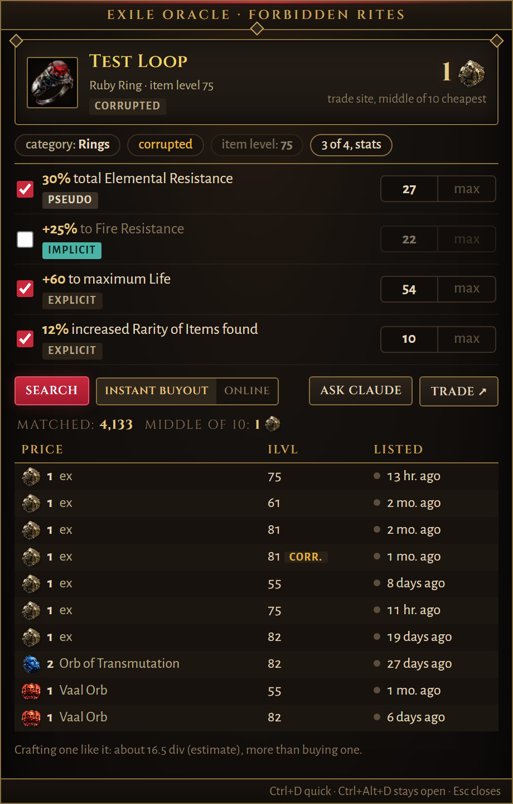

### Build Lab (new in 0.5.0)
The Oracle's workbench for one build: ask in chat, and what it works out shows here.

- **Living roadmap.** Drag the level from 1 to 100 and the passive tree lights up in the order you take nodes, with the
  skills, supports and gear for that level, plus quest points and trials on the slider.
- **Power curves.** Real Path of Building runs at each level, for DPS and toughness, with your geared build marked.


- **What-if bench.** The Oracle's suggestions as cards, each measured by Path of Building (DPS, EHP, max hits,
  resistances) with its cost.

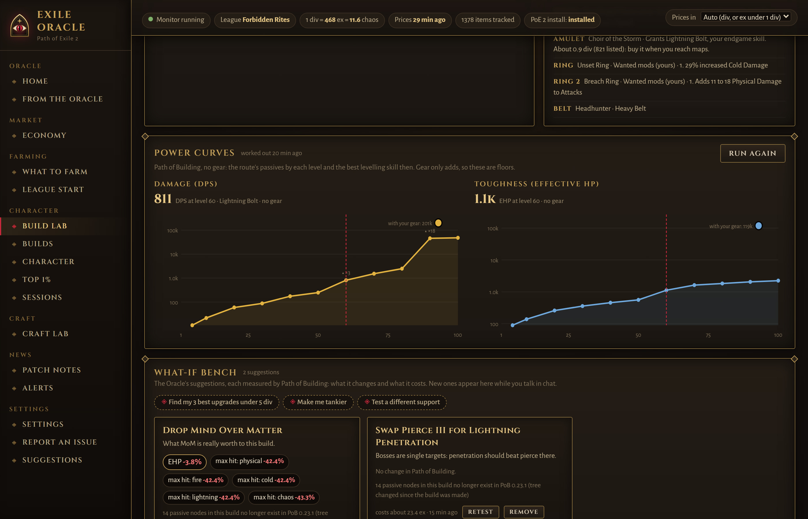

- **Upgrade ranking and defence sheet.** Every affordable unique in every slot ranked by DPS per divine, with a
  "budget path", next to the biggest hit you survive per damage type and the gaps in red.

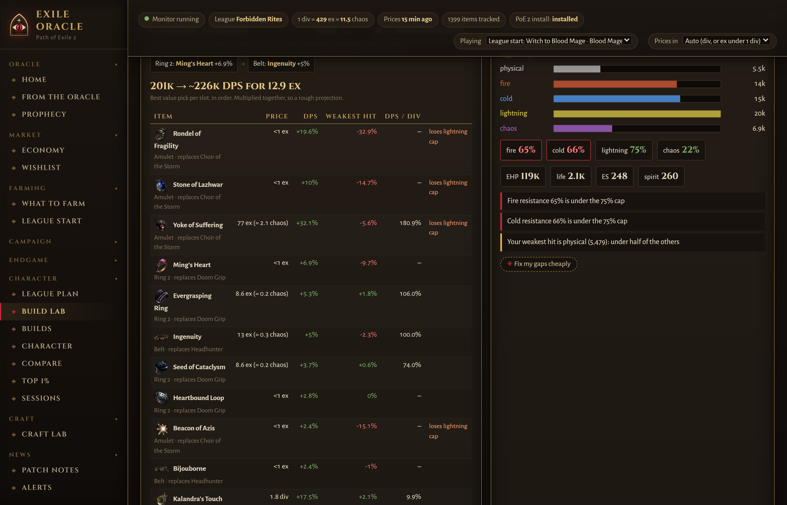

- **Boss readiness, history and the Oracle feed.**
  - Ready / risky / not yet for every pinnacle boss, against researched minimums with their sources.
  - Your character over time.
  - A live feed of what the Oracle is doing in any chat.

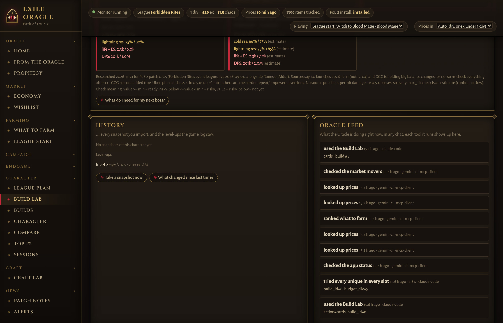

### Prophecy (new in 0.6.0)
The Oracle that tells the future, built from researched league history ([the research](research/README.md)):

- a **daily omen** with its evidence;
- **countdowns** to 1.0 and to each league phase;
- a **league timeline** from day 0 to day 70+, with "you are here".

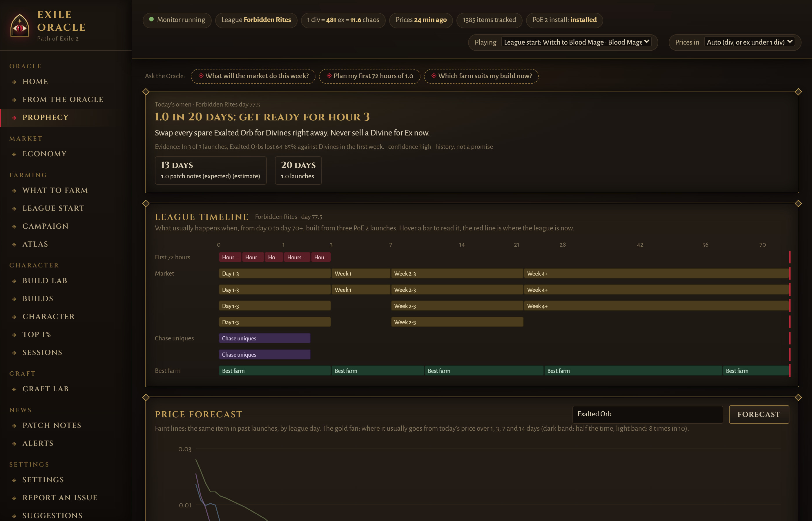

**Price forecasts** for 688 exchange items: past launches as faint lines, and a fan for the next 1, 3, 7 and 14 days.
Tested on six launches, the range held the real price 79% of the time.


**Patch prophecy** reads every new patch post the app picks up and says which items should move, and how much. Its
rulebook is measured on 276 PoE 2 patches. The **farming oracle** gives div per hour per strategy, checked against
your build.


**Chase uniques through a league:** Mageblood, Headhunter, Temporalis and 45 more, by league day.

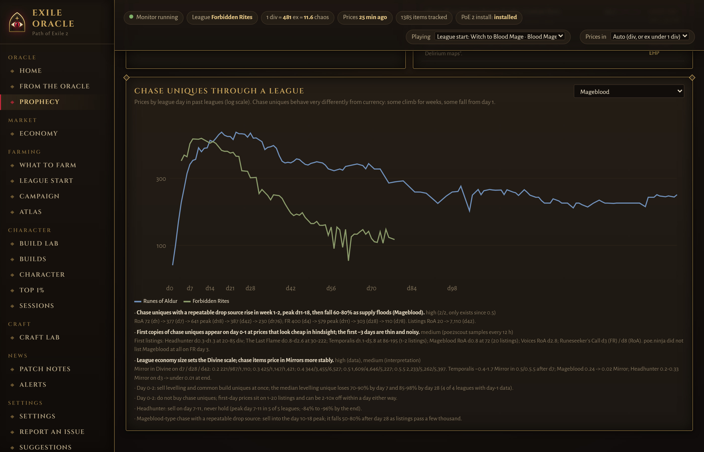

### The Oracle's market timing
What to sell, hold or buy at this point of the league, from three launches.


### Endgame: Atlas (new in 0.6.0)
- The atlas tree, read from your own game files.
- **Show on tree** draws a strategy's whole setup: its key nodes and the path to them.

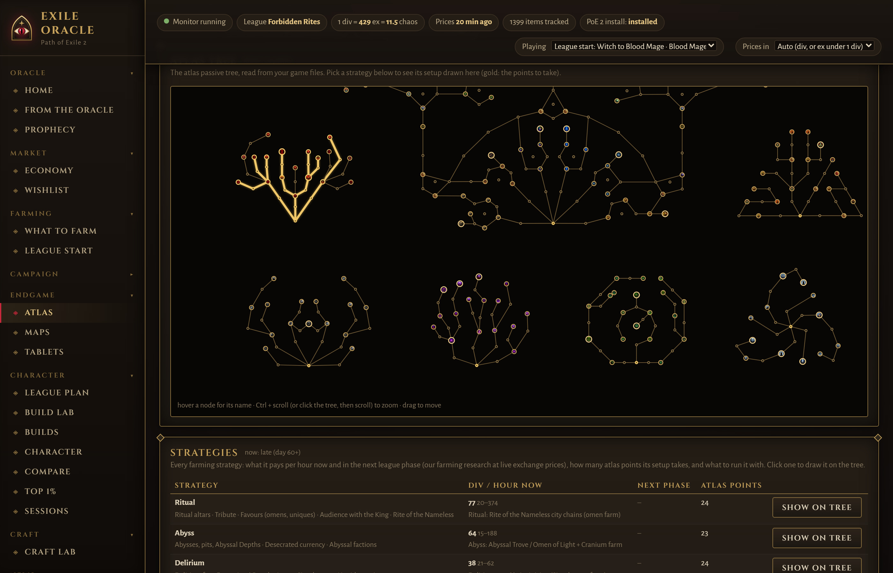

Eleven strategies with div per hour now and in the next league phase, the atlas points each takes, and when to switch.


### Endgame: Maps (new in 0.6.0)
Waystone rolling at live prices, and a juicing calculator: what a map costs to set up vs what your strategy returns.


Every waystone mod rated deadly / risky / fine for **your** build, with our own in-game search strings.

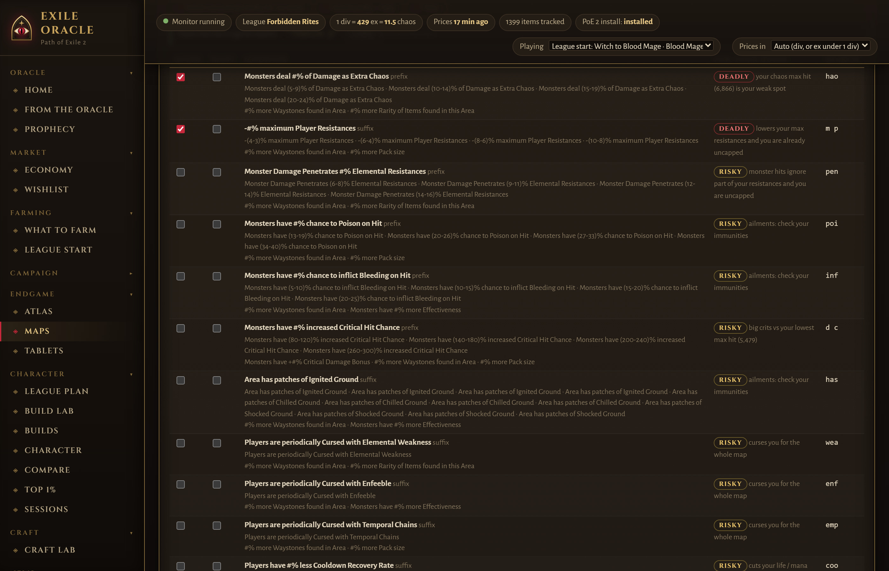

### Endgame: Tablets (new in 0.6.0)
Every tablet type with its own modifiers, what to pair with each strategy, and tablet modifiers with search strings.

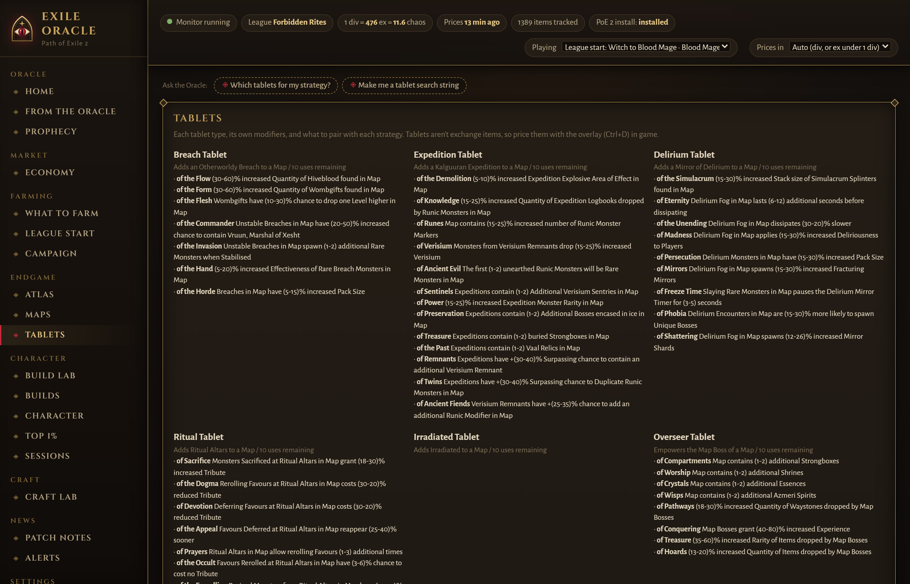

### Campaign + the route panel (new in 0.6.0)
The fastest route act by act, every permanent reward with a checklist, the trials, and flask / boots / life breakpoints.


**In game**, a small corner card follows your zone (read from the game's own log): where to go next, rewards not to
skip, trials and tips. It's click-through, never takes focus, and hides in your hideout and in maps. Ctrl+Alt+R shows
or hides it.

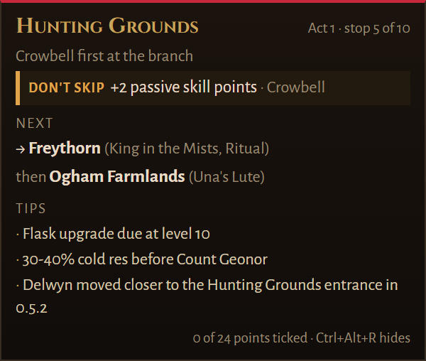

### Waystone check + your own keys (new in 0.6.0)
Ctrl+D on a waystone or tablet: every mod rated for your build, the rewards, and a verdict. The price-check keys can be
changed in the overlay settings, with a warning when a key clashes with the game or another program.

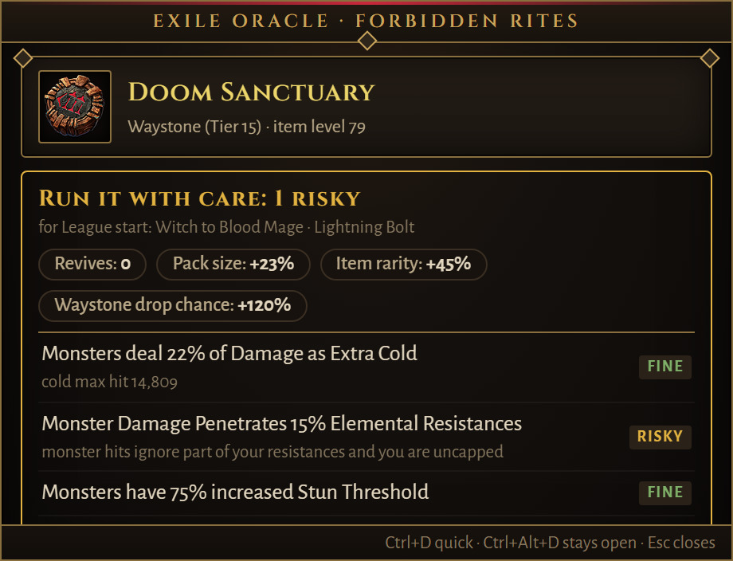

### Several characters
**Playing** in the top bar picks your active character. The Build Lab, Atlas, waystone check, farming oracle, Top 1%
and the AI tools all follow it.

### Other AI apps
Exile Oracle's tools are a standard MCP server. Settings → **Other AI apps** connects them to the ChatGPT desktop app
/ Codex or Gemini CLI as well as Claude. ChatGPT is marked *untested* until a player confirms it.

### Report an issue / Suggestions
Two forms in the menu send your words straight to the developer. There's no sign-in: your copy reports anonymously,
and you can see exactly what is sent first.

### Economy
Mirror, Divine and the league's chase items at a glance.


### Market history
Every Currency Exchange item: price, stock, 7-day trend.


### Character
Gear, skills and real DPS from Path of Building.

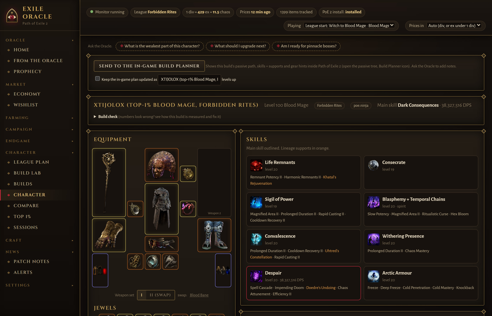

### Passive tree + build value
Your tree, and every item priced (rares estimated from craft cost).


### Top 1% check
You vs the top 1% of your ascendancy: level, DPS, toughness, gear value.

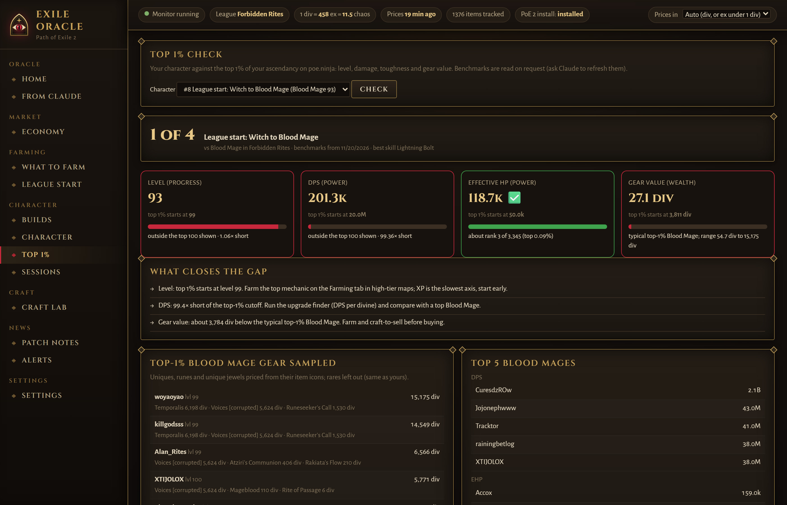

**View profile** opens a top player's poe.ninja page inside Exile Oracle, with a **Save this build** button.

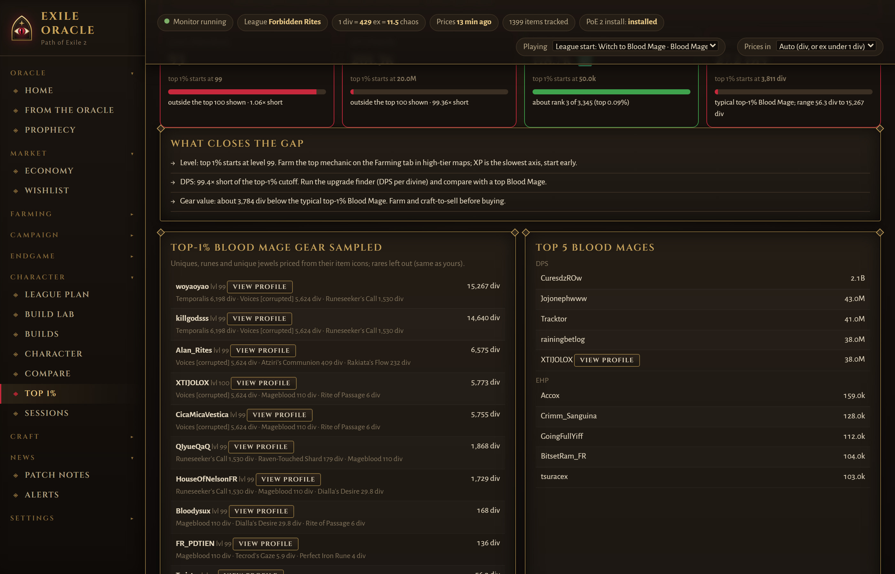

### From the Oracle
Ask in chat and Claude puts the answer on your dashboard (here: your build vs a top-1% Blood Mage).


### What to farm
League mechanics ranked by what actually sells, with drop estimates from tracked runs.


### League start playbook
What each mechanic's loot sold for on days 1–7 of the last three launches.

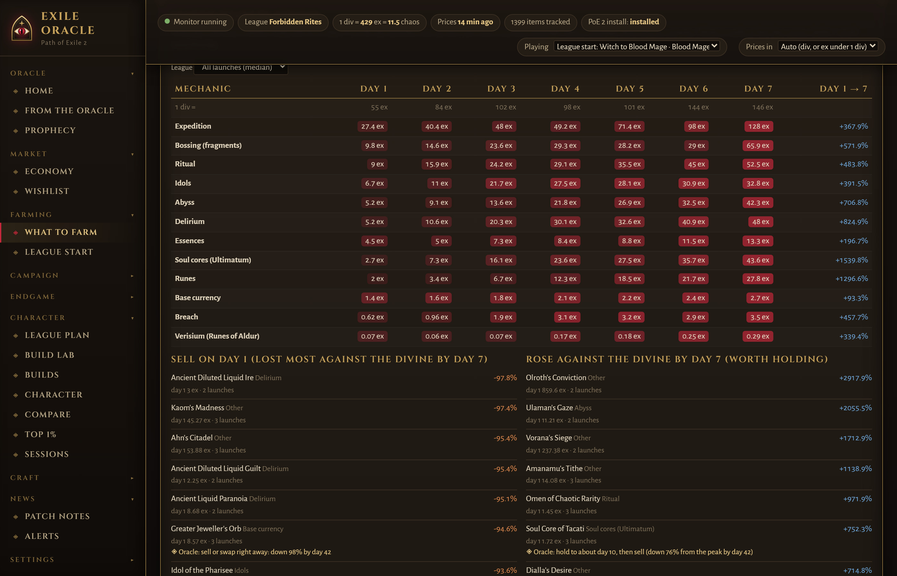

### League start planner
Any class, any ascendancy path: skills to cut, cheap leveling uniques, campaign rewards.


### Sessions
Your play time from the game's own log file: maps per hour, average map time, deaths, and time per act.

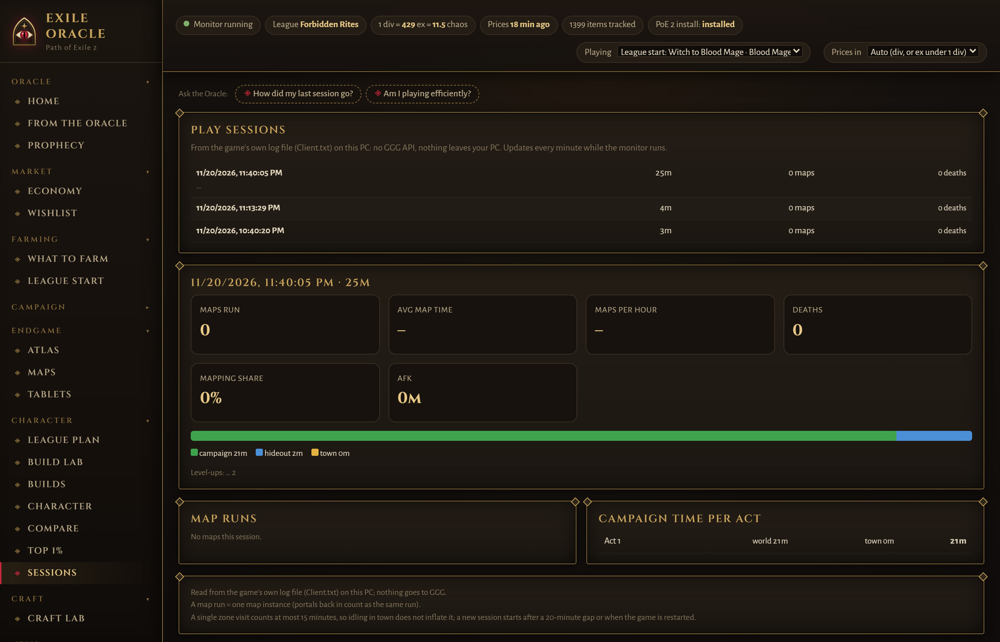

### Craft lab
Plan a craft, practise it step by step, record what really happened in game.


### Patch notes
Every line of a patch that hits your builds, with buff / nerf tags.


### Game data that updates itself
After a patch (1.0 included), what Exile Oracle knows about the game (zones, atlas, campaign rewards, research)
updates by itself within hours: a small data update, checked file by file before it's used, with the previous data
kept so it can go back. Nothing to install. New features still come as app updates with the banner. Settings shows
the data version and has **Check now** and **Go back**.

### Settings + Connect to Claude
Your profile, league, text size, the overlay and its keys, and Claude (or another AI app) connected with one click.

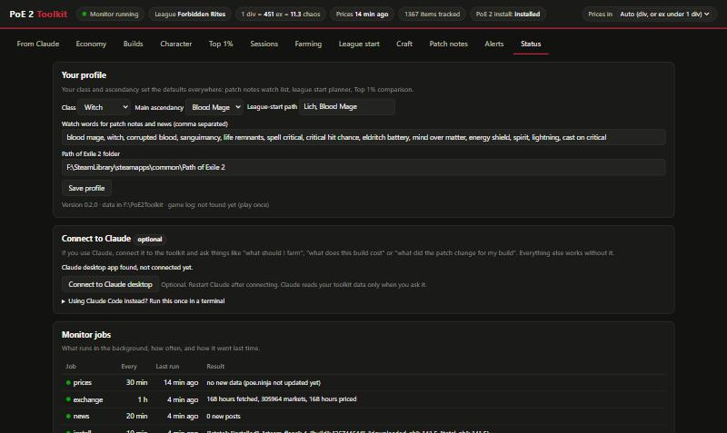

## Early stage
This is a young project: things can break. If something doesn't work:
- **With Claude:** ask it to fix it. It runs `poe2_doctor` (checks every part) and follows
  **[TROUBLESHOOTING.md](TROUBLESHOOTING.md)**, which is written for Claude: checks, safe restarts and fixes.
- **Without Claude:** TROUBLESHOOTING.md works for people too.
- **Still stuck?** **[Open an issue](../../issues/new?template=bug_report.md)**.

## Install
1. Download `ExileOracle-Setup-<version>.exe` from **[Releases](../../releases/latest)** and run it.
   Windows may say *"Windows protected your PC"* (the installer isn't code-signed): **More info → Run anyway**.
2. It installs for your Windows user (no admin) and starts; the Exile Oracle eye appears by the clock. Click it for the
   dashboard (its own window); right-click for *Start with Windows* and *Quit*.
3. First start downloads prices, the community game data and Path of Building (about 2 minutes).
4. **Settings → Your profile:** pick your class and ascendancy.
5. **Connect to Claude** (Settings) — see **[the Claude guide](CLAUDE-GUIDE.md)**.

Updates: the dashboard shows a banner when a new version is out; one click downloads and installs it.

### Linux and Steam Deck
1. Download `exile-oracle-linux-x86_64-<version>.tar.gz` from **[Releases](../../releases/latest)** and unpack it.
2. In a terminal in that folder: `sh install.sh` (add `--autostart` to start it when you log in). It installs
   for your user only, with no sudo and nothing system-wide, and it brings its own Python and Lua, so it works on
   SteamOS's read-only system too.
3. Open **Exile Oracle** from the app menu, or `http://127.0.0.1:47830` in your browser.
   On a Steam Deck, do this in Desktop Mode. Right-click the menu entry and choose *Add to Steam* to open it from
   Game Mode.

It finds the game through Steam (including Flatpak Steam and SD cards) and reads its log through Proton. If you
run Path of Building under Wine or Proton it finds that too, for character import.
- Your data stays in `~/.local/share/poe2toolkit`.
- `sh uninstall.sh` removes the app (add `--purge` to remove your data as well).
- The price-check overlay is Windows-only for now.
- Connect Claude Code with the command `install.sh` prints.

## Price-check overlay (Windows)
Press **Ctrl+C** on an item in game (plain or Ctrl+Alt+C) and a popup appears by your mouse:
- **poe.ninja** price and 7-day trend for currency, gems, runes, fragments and uniques;
- **live trade-site prices** for rares and rolled uniques (optional, see below):
  - the stats come in as rows you can tick and edit, then **Search** again;
  - the cheapest listings show with item level, how long ago they were listed, and an online dot;
- our **craft-cost estimate** for rares, and **Trade ↗** to open the same search on pathofexile.com.

Run the game in **windowed fullscreen** so the popup can show over it. Press Esc or move the mouse away to close
it. Switch it on or off on the **Status** tab.

**Live trade-site prices are off by default and are your choice.** They use GGG's trade site the way Exiled
Exchange 2 and similar tools do, which is not a documented public API. The toolkit keeps it light:
- one search each time you copy an item or press Search;
- GGG's rate-limit headers are obeyed, and if a wait would be long it skips and says so;
- no login, nothing in the background.

The overlay only reads what you copy. It never presses keys in the game.

## The research behind the Oracle

Every prediction in the app comes from research you can read and re-run in [research/](research/README.md):
market trends over three launches, the first 72 hours hour by hour, a price forecast tested on six launches, 276
patches matched to the price moves after them, divines per hour for 22 farming strategies, chase uniques over five
leagues, 20+ PoE 1 leagues as labelled analogy, the atlas, the campaign and boss requirements. Each topic has a report,
its data and the scripts that measured it; findings are tagged by how sure they are, and community claims are checked
against the data.

## What it uses (and what it never does)
- **Public data only:** poe.ninja's economy data, GGG's public Currency Exchange history, Steam news, the community
  game-data export (RePoE), Path of Building (downloaded on first run), and the game's own log file on your PC.
- **Read-only toward the game:** no input to the game, no memory reading, no changes to game files, no logins
  handled by the toolkit (your GGG login stays inside Path of Building). The trade site is used only by the
  optional overlay setting above.
- **Polite:** prices every 30 minutes, exchange history hourly.
- **Nothing about you leaves your PC.**

## Build it yourself
Needs Python 3.15, Inno Setup 7 and (for the bundled art) a local extraction of your own game files:
```
python make_datapack.py          # refresh the data pack
python build_release.py --setup  # stage + privacy scan + installer -> F:\Tools\poe2kit-build\out
```

## Credits and licences
See [release/LICENSES.md](release/LICENSES.md). Path of Building Community (MIT), RePoE, poe.ninja, Python.
**Not affiliated with or endorsed by Grinding Gear Games.** Path of Exile and all of its artwork are © Grinding Gear
Games; this free, non-commercial fan tool bundles some game art for its pictures and icon, and will remove it on
request.
