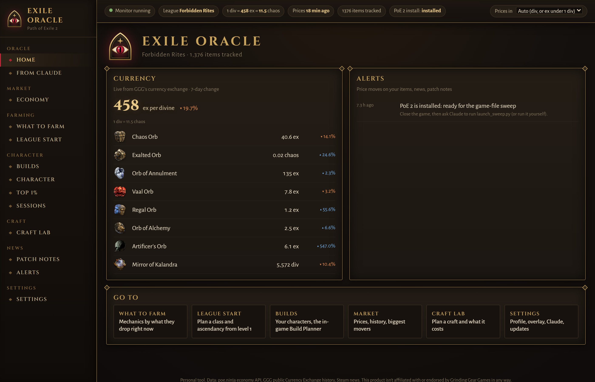
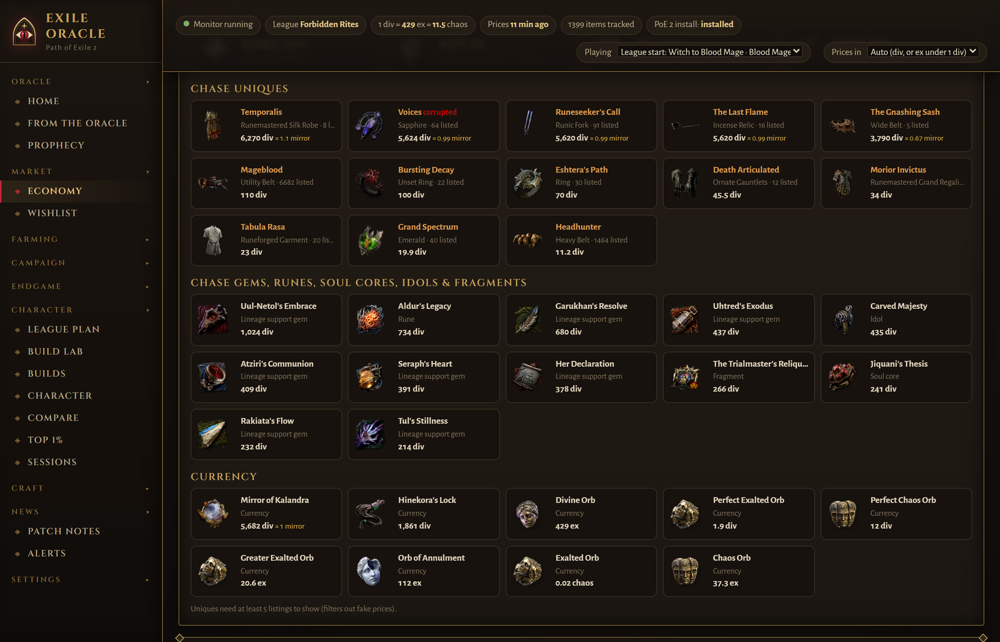
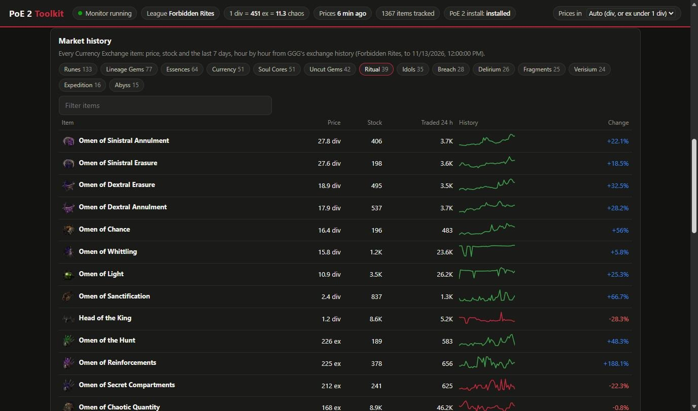
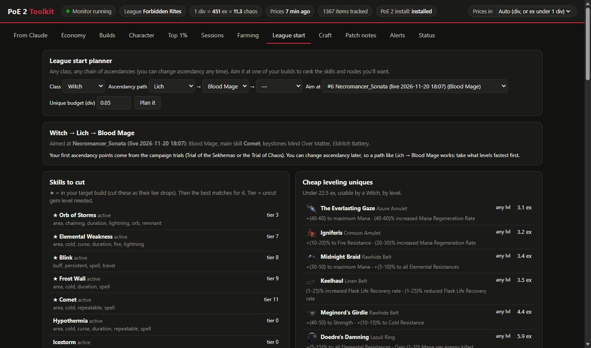
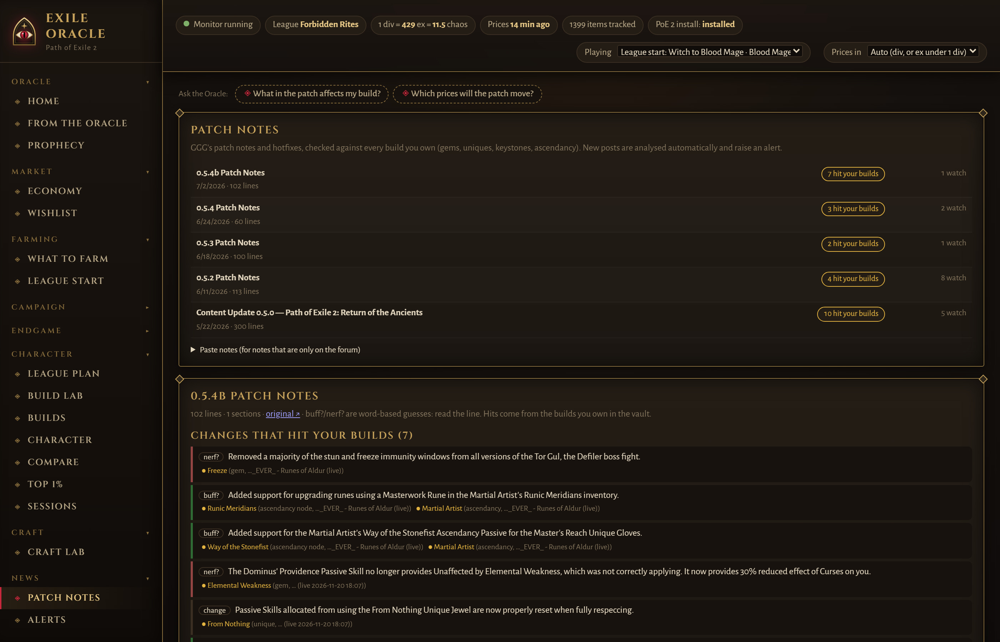

# Exile Oracle

*(formerly PoE 2 Toolkit)*

A free, personal **Path of Exile 2 companion** for Windows and Linux: live economy, what to farm, a league-start
playbook, a Top 1% check for your character, play-session tracking, a craft lab, patch notes checked against your
builds, and an in-game price-check overlay. It runs on your own PC in its own window, and it's built to be used
**together with Claude**: connect it once and ask Claude anything about your character, the economy or your next
craft.

**[⬇ Download the latest installer](../../releases/latest)** · **[Using it with Claude](CLAUDE-GUIDE.md)**

> Character screenshots show a public top-player build from poe.ninja. Yours shows your own characters after you import them.

## Screenshots

### Home
The Divine rate and the main currencies with their 7-day change, your latest alerts, and a way into everything else.



### Price-check overlay (Windows)
Ctrl+D on an item in game: poe.ninja and live trade-site prices (optional), a craft estimate, and Ask the Oracle (sends the item to Claude).
Ctrl+Alt+D keeps it open so you can tick rows and search again. F5 / F9 and your own chat commands work too.


### Economy
Mirror, Divine and the league's chase items at a glance.



### Market history
Every Currency Exchange item: price, stock, 7-day trend.



### Character
Gear, skills and real DPS from Path of Building.


### Passive tree + build value
Your tree, and every item priced (rares estimated from craft cost).


### Top 1% check
You vs the top 1% of your ascendancy: level, DPS, toughness, gear value.


### From the Oracle
Ask in chat and Claude puts the answer on your dashboard (here: your build vs a top-1% Blood Mage).


### What to farm
League mechanics ranked by what actually sells, with drop estimates from tracked runs.


### League start playbook
What each mechanic's loot sold for on days 1–7 of the last three launches.


### League start planner
Any class, any ascendancy path: skills to cut, cheap leveling uniques, campaign rewards.



### Craft lab
Plan a craft, practise it step by step, record what really happened in game.


### Patch notes
Every line of a patch that hits your builds, with buff / nerf tags.



### Your profile + Connect to Claude
Set your class once, connect Claude with one click.


## Early stage
This is a young project: things can break. If something doesn't work:
- **With Claude:** ask it to fix it. It runs `poe2_doctor` (checks every part) and follows
  **[TROUBLESHOOTING.md](TROUBLESHOOTING.md)**, which is written for Claude: checks, safe restarts and fixes.
- **Without Claude:** TROUBLESHOOTING.md works for people too.
- **Still stuck?** **[Open an issue](../../issues/new?template=bug_report.md)**.

## Install
1. Download `ExileOracle-Setup-<version>.exe` from **[Releases](../../releases/latest)** and run it.
   Windows may say *"Windows protected your PC"* (the installer isn't code-signed): **More info → Run anyway**.
2. It installs for your Windows user (no admin) and starts; the Exile Oracle eye appears by the clock. Click it for the
   dashboard (its own window); right-click for *Start with Windows* and *Quit*.
3. First start downloads prices, the community game data and Path of Building (about 2 minutes).
4. **Settings → Your profile:** pick your class and ascendancy.
5. **Connect to Claude** (Settings) — see **[the Claude guide](CLAUDE-GUIDE.md)**.

Updates: the dashboard shows a banner when a new version is out; one click downloads and installs it.

### Linux and Steam Deck
1. Download `exile-oracle-linux-x86_64-<version>.tar.gz` from **[Releases](../../releases/latest)** and unpack it.
2. In a terminal in that folder: `sh install.sh` (add `--autostart` to start it when you log in). It installs
   for your user only, with no sudo and nothing system-wide, and it brings its own Python and Lua, so it works on
   SteamOS's read-only system too.
3. Open **Exile Oracle** from the app menu, or `http://127.0.0.1:47830` in your browser.
   On a Steam Deck, do this in Desktop Mode. Right-click the menu entry and choose *Add to Steam* to open it from
   Game Mode.

It finds the game through Steam (including Flatpak Steam and SD cards) and reads its log through Proton. If you
run Path of Building under Wine or Proton it finds that too, for character import.
- Your data stays in `~/.local/share/poe2toolkit`.
- `sh uninstall.sh` removes the app (add `--purge` to remove your data as well).
- The price-check overlay is Windows-only for now.
- Connect Claude Code with the command `install.sh` prints.

## Price-check overlay (Windows)
Press **Ctrl+C** on an item in game (plain or Ctrl+Alt+C) and a popup appears by your mouse:
- **poe.ninja** price and 7-day trend for currency, gems, runes, fragments and uniques;
- **live trade-site prices** for rares and rolled uniques (optional, see below):
  - the stats come in as rows you can tick and edit, then **Search** again;
  - the cheapest listings show with item level, how long ago they were listed, and an online dot;
- our **craft-cost estimate** for rares, and **Trade ↗** to open the same search on pathofexile.com.

Run the game in **windowed fullscreen** so the popup can show over it. Press Esc or move the mouse away to close
it. Switch it on or off on the **Status** tab.

**Live trade-site prices are off by default and are your choice.** They use GGG's trade site the way Exiled
Exchange 2 and similar tools do, which is not a documented public API. The toolkit keeps it light:
- one search each time you copy an item or press Search;
- GGG's rate-limit headers are obeyed, and if a wait would be long it skips and says so;
- no login, nothing in the background.

The overlay only reads what you copy. It never presses keys in the game.

## What it uses (and what it never does)
- **Public data only:** poe.ninja's economy data, GGG's public Currency Exchange history, Steam news, the community
  game-data export (RePoE), Path of Building (downloaded on first run), and the game's own log file on your PC.
- **Read-only toward the game:** no input to the game, no memory reading, no changes to game files, no logins
  handled by the toolkit (your GGG login stays inside Path of Building). The trade site is used only by the
  optional overlay setting above.
- **Polite:** prices every 30 minutes, exchange history hourly.
- **Nothing about you leaves your PC.**

## Build it yourself
Needs Python 3.15, Inno Setup 7 and (for the bundled art) a local extraction of your own game files:
```
python make_datapack.py          # refresh the data pack
python build_release.py --setup  # stage + privacy scan + installer -> F:\Tools\poe2kit-build\out
```

## Credits and licences
See [release/LICENSES.md](release/LICENSES.md). Path of Building Community (MIT), RePoE, poe.ninja, Python.
**Not affiliated with or endorsed by Grinding Gear Games.** Path of Exile and all of its artwork are © Grinding Gear
Games; this free, non-commercial fan tool bundles some game art for its pictures and icon, and will remove it on
request.
